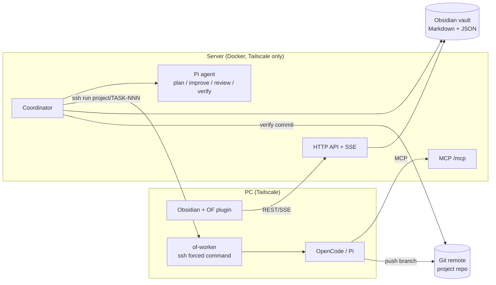

# Obsidian Framework

**English** · [Русский](README.ru.md)

Obsidian Framework (OF) runs the **AIF** methodology ([ai-factory](https://github.com/lee-to/ai-factory) skills + the `aif-handoff` task pipeline) on top of a plain **Obsidian vault**. Tasks are Markdown files with frontmatter, the board is an Obsidian plugin, and AI agents plan, implement, review and verify tasks automatically.

- **The vault is the database.** Projects, tasks, plans, journals and state are Markdown/JSON files you can read and edit in Obsidian.
- **The backend is the only writer.** Humans (plugin) and agents (MCP) change tasks only through the server API, so every transition is validated by the AIF state machine and journaled.
- **Coordinator + workers.** A coordinator on a home server drives the pipeline; heavy coding runs on your PC over ssh via Tailscale.
- **Model chains.** Each role has an ordered list of models; when a model hits a rate/subscription limit OF switches to the next one without burning a retry.

> Status: 0.1.0, used in production by the author. UI strings and vault folder names are in Russian (`Проекты`, `Задачи`, `Доска.md`); paths are configurable via env.

## Architecture



| Package | What it does |
|---|---|
| `packages/core` | Task model, frontmatter/Markdown, AIF state machine, flags, watchdog, review gate, journal, `models.json` chains |
| `packages/server` | HTTP API, MCP server, coordinator, Pi RPC runner, ssh runner for `of-worker`, git clone/commit verification |
| `packages/worker` | `of-worker` CLI on the PC: `status`, `run <project>/TASK-NNN`; one git worktree per task, runs OpenCode or Pi |
| `packages/plugin` | Obsidian plugin: kanban board (drag & drop = AIF events), task history, handoff, models editor, live SSE updates |
| `deploy/` | Dockerfile + compose for the server, install scripts for the PC, examples |

### Vault layout

```
<vault>/
  .framework/                     ← this repository
  Проекты/<Project>/
    Проект.md                     ← project frontmatter (id, repo, default_branch, …)
    Доска.md                      ← board marker, opened by the plugin as a kanban view
    Задачи/TASK-001.md            ← tasks (frontmatter + plan + log)
    Архив/                        ← archived tasks
    _журнал/YYYY-MM.md            ← append-only journal
    _состояние/                   ← backend state (locks, models-state.json)
  Проекты/Obsidian Framework/models.json   ← model chains per role
```

### Statuses and flags (AIF)

`backlog → planning → (improve) → plan_ready → implementing → (review ⇄ implementing) → done → (verify) → verified`, plus `blocked_external`.

- `planning`, `improve`, `review`, `verify` run **Pi on the server**.
- plan-checker and `implementing` run **on the PC** over ssh (`of-worker run …`). If the PC is offline, the task waits in `plan_ready` and the coordinator probes the PC every 5 minutes.
- After the worker's ssh session ends, the coordinator verifies the commit and moves `implementing → review` (or to `done` in fast mode).
- `planner_mode: fast` (default) skips review and plan docs/tests; `planner_mode: full` enables them. Other flags 1:1 with aif-handoff: `auto_mode`, `skip_review`, `plan_docs`, `plan_tests`, `run_plan_improve`, `run_post_verify`, `use_subagents`, `max_review_iterations` (1..50, default 3), `is_fix`, `auto_qa`, `paused`, `priority`, `runtime_profile` (`opencode` | `pi`).
- A watchdog returns stale agent stages, a lock TTL protects against double runs, `retry_count` grows only on real failures.

### MCP tools

`handoff_list_projects`, `handoff_list_tasks`, `handoff_get_task`, `handoff_search_tasks`, `handoff_create_task`, `handoff_update_task`, `handoff_sync_status`, `handoff_push_plan`, `handoff_annotate_plan`, `handoff_to_aif`, `of_add_commit`, `of_models_get`, `of_models_update`.

## Quick start

Requirements: Linux server with Docker, a PC with Node ≥ 20.11 (24 recommended), [Tailscale](https://tailscale.com) on both, an Obsidian vault reachable from the server (local disk, Syncthing, SMB…), a git remote for each project, [OpenCode](https://opencode.ai) and/or [Pi](https://www.npmjs.com/package/@earendil-works/pi-coding-agent) with the AIF skills.

Clone this repository **into the vault** as `.framework`:

```bash
git clone https://github.com/tikhomirov/obsidian-framework.git <vault>/.framework
```

### 1. Server (Docker)

```bash
bash <vault>/.framework/deploy/server/install.sh ~/stacks/obsidian-framework
# edit ~/stacks/obsidian-framework/.env: VAULT_DIR, TAILSCALE_IP, PUID/PGID, OF_WORKER_SSH_TARGET, GIT_HOST
bash <vault>/.framework/deploy/server/install.sh ~/stacks/obsidian-framework   # again: known_hosts
cd ~/stacks/obsidian-framework && docker compose up -d --build
curl http://<TAILSCALE_IP>:8787/health
```

`install.sh` is idempotent and never overwrites secrets. It generates API tokens (`config/tokens.json`), an ssh key for the coordinator and a read-only deploy key, and prints the public keys:

- add `config/deploy_key.pub` as a **read-only deploy key** of the project repo;
- put Pi credentials/models into `pi-home/agent/` and the AIF skills (`aif-plan`, `aif-improve`, `aif-review`, `aif-verify`) into `pi-home/agent/skills/`.

The port is published **only on the Tailscale address**. If Docker Hub is unreachable, set `BASE_IMAGE` + `NODE_TARBALL_VERSION` in `.env` (see `.env.example`).

### 2. PC: sshd on Tailscale + of-worker

```bash
sudo bash <vault>/.framework/deploy/pc/setup-sshd.sh     # sshd listens only on the Tailscale IP, keys only
bash <vault>/.framework/deploy/pc/install-of-worker.sh   # ~/.local/bin/of-worker + ~/.config/obsidian-framework/worker.json
```

1. Edit `~/.config/obsidian-framework/worker.json` (see `deploy/pc/worker.example.json`): `serverUrl`, the `pc-worker` token, and `projects` → path of a local clone of each project repo.
2. Add the single line printed by the server's `install.sh` to `~/.ssh/authorized_keys`:
   `command="$HOME/.local/bin/of-worker",restrict ssh-ed25519 AAAA… of-coordinator` — the key can only run `of-worker`.
3. Install the AIF skills for OpenCode (`aif-implement`, `aif-plan`).
4. Check from the server: `docker exec of-server ssh -i /config/worker_ssh_key -o UserKnownHostsFile=/config/known_hosts user@<pc> status` → `{"ok":true,…}`.

### 3. MCP for agents (manual mode)

OpenCode (`~/.config/opencode/opencode.jsonc`):

```jsonc
"mcp": {
  "obsidian-framework": {
    "type": "remote",
    "url": "http://<server>:8787/mcp",
    "headers": { "Authorization": "Bearer {env:OF_MCP_TOKEN}" }
  }
}
```

`OF_MCP_TOKEN` = the `agent-mcp` token from `config/tokens.json`. For Pi, the same server goes into `~/.pi/agent/mcp.json`.

### 4. Obsidian plugin

```bash
bash <vault>/.framework/deploy/pc/install-plugin.sh
```

Enable **Obsidian Framework** in *Settings → Community plugins*, set the server URL (Tailscale address) and the `owner-plugin` token. Open `Проекты/<Project>/Доска.md` (or the ribbon icon / `Ctrl+P → Open task board`): create a task, drag it to *Planning* and watch it move through the pipeline. The status bar shows whether the PC worker is online.

### 5. Project and models

- `Проекты/<Project>/Проект.md` — see `deploy/project.example.md` (`repo` is the git URL).
- `Проекты/Obsidian Framework/models.json` — see `deploy/models.example.json`:

```json
{
  "version": 1,
  "default_cooldown_minutes": 300,
  "roles": {
    "worker": { "opencode": ["provider/main-model", "provider/fallback"], "pi": ["provider/model"] },
    "planning": ["provider/model", "provider/fallback"],
    "improve": ["provider/model"],
    "review": ["provider/model"],
    "verify": ["provider/model"]
  }
}
```

On a limit the coordinator marks the model as cooling down until a time, emits `task.model_switched` and takes the next model; if none is available the task waits (`task.waiting_model`). State lives in `_состояние/models-state.json` (don't edit by hand). The plugin's **Models** button shows and edits the chains; agents change them only via `of_models_update`. A broken file is ignored (last valid version stays, `models.invalid` event).

## Configuration (server env)

| Variable | Default | Meaning |
|---|---|---|
| `OF_VAULT_DIR` | `/vault` (Docker) | Vault root |
| `OF_PROJECTS_DIR` | `Проекты` | Projects folder inside the vault |
| `OF_FRAMEWORK_DIR` | `Проекты/Obsidian Framework` | Folder with `models.json` |
| `OF_HOST` / `OF_PORT` | `127.0.0.1` / `8787` | Listen address |
| `OF_TOKENS_FILE`, `OF_PARTICIPANTS_FILE` | — | Tokens and participants JSON |
| `OF_WORKER_SSH_TARGET`, `OF_WORKER_SSH_KEY`, `OF_WORKER_SSH_OPTIONS` | — | ssh to the PC worker |
| `OF_POLL_INTERVAL_MS` | `30000` | Coordinator tick |
| `OF_WORKER_PROBE_INTERVAL_MS` | 5 min | PC online probe |
| `OF_AUTOARCHIVE_DAYS` | `7` | Auto-archive of finished tasks |
| `OF_TZ_OFFSET_MINUTES` | `180` | Timezone offset for journal timestamps |
| `OF_COORDINATOR_ENABLED` | `true` | Disable to run API/MCP only |

## Development

```bash
npm ci
npm run typecheck   # tsc, strict
npm run lint        # eslint strict-type-checked, 0 warnings
npm test            # vitest
npm run check       # all of the above + coverage thresholds
npm run build       # server dist, plugin main.js, of-worker bundle
```

If the vault lives on a network share (CIFS/SMB), don't run `npm ci` there — build in a local copy (`deploy/pc/_build.sh` does this automatically).

## Security notes

- API, MCP and sshd are exposed **only on Tailscale**; the plugin warns if the server URL is not a Tailscale/localhost address.
- Separate tokens per role: `participant` (plugin), `agent` (MCP), `worker` (of-worker).
- The coordinator's ssh key is restricted with `command="…/of-worker",restrict`; the git deploy key is read-only; worker changes land in a task branch, never directly in `main`.
- Never commit `.env`, `config/`, `pi-home/` or the plugin's `data.json` — they are git-ignored.

## License

[MIT](LICENSE) © 2026 Aleksei Tikhomirov
