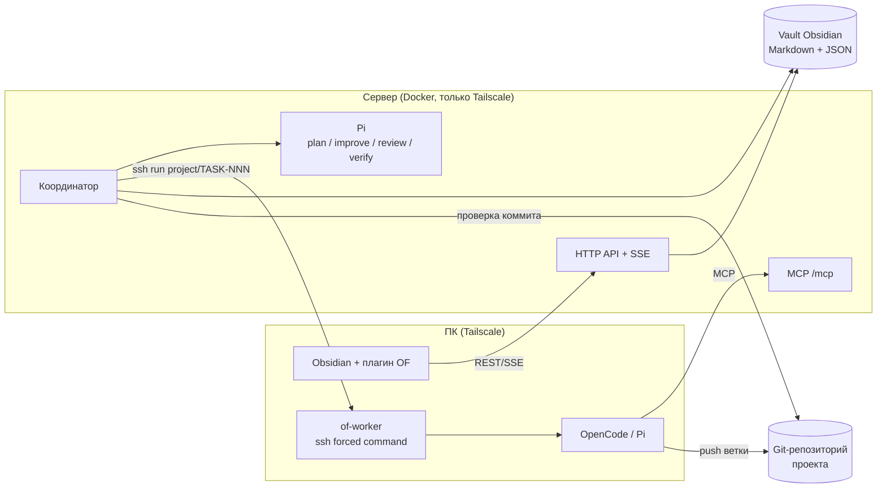

# Obsidian Framework

[English](README.md) · **Русский**

Obsidian Framework (OF) переносит методологию **AIF** (скилы [ai-factory](https://github.com/lee-to/ai-factory) + конвейер задач `aif-handoff`) на обычный **vault Obsidian**. Задачи — Markdown-файлы с frontmatter, доска — плагин Obsidian, а ИИ-агенты сами планируют, делают, ревьюят и проверяют задачи.

- **Vault — это база данных.** Проекты, задачи, планы, журналы и состояние лежат в Markdown/JSON, их видно и можно править в Obsidian.
- **Бэкенд — единственный путь записи.** Люди (плагин) и агенты (MCP) меняют задачи только через API сервера: каждый переход проверяется машиной состояний AIF и пишется в журнал.
- **Координатор + воркеры.** Координатор на домашнем сервере ведёт конвейер, код пишется на ПК через ssh по Tailscale.
- **Цепочки моделей.** У каждой роли список моделей по приоритету: при лимите OF переключается на следующую, `retry_count` не растёт.

## Архитектура



| Пакет | Что делает |
|---|---|
| `packages/core` | Модель задачи, frontmatter/Markdown, машина состояний AIF, флаги, watchdog, review gate, журнал, цепочки `models.json` |
| `packages/server` | HTTP API, MCP, координатор, запуск Pi (RPC), ssh-запуск `of-worker`, git-клон и проверка коммитов |
| `packages/worker` | `of-worker` на ПК: `status`, `run <project>/TASK-NNN`; отдельный worktree на задачу, запускает OpenCode или Pi |
| `packages/plugin` | Плагин Obsidian: канбан (drag & drop = события AIF), история, handoff, редактор моделей, обновления по SSE |
| `deploy/` | Dockerfile и compose для сервера, скрипты установки на ПК, примеры |

### Структура vault

```
<vault>/
  .framework/                     ← этот репозиторий
  Проекты/<Проект>/
    Проект.md                     ← frontmatter проекта (id, repo, default_branch, …)
    Доска.md                      ← маркер доски, плагин открывает его как канбан
    Задачи/TASK-001.md            ← задачи (frontmatter + план + лог)
    Архив/                        ← архив задач
    _журнал/ГГГГ-ММ.md            ← журнал (только дописывается)
    _состояние/                   ← состояние бэкенда (локи, models-state.json)
  Проекты/Obsidian Framework/models.json   ← цепочки моделей по ролям
```

### Статусы и флаги (AIF)

`backlog → planning → (improve) → plan_ready → implementing → (review ⇄ implementing) → done → (verify) → verified`, плюс `blocked_external`.

- `planning`, `improve`, `review`, `verify` — **Pi на сервере**.
- plan-checker и `implementing` — **на ПК** по ssh (`of-worker run …`). Если ПК выключен, задача ждёт в `plan_ready`, координатор проверяет ПК раз в 5 минут.
- Когда ssh-сессия воркера закончилась, координатор проверяет коммит и переводит `implementing → review` (или в `done` в быстром режиме).
- `planner_mode: fast` (по умолчанию) пропускает ревью и docs/tests в плане, `planner_mode: full` включает их. Остальные флаги 1:1 с aif-handoff: `auto_mode`, `skip_review`, `plan_docs`, `plan_tests`, `run_plan_improve`, `run_post_verify`, `use_subagents`, `max_review_iterations` (1..50, по умолчанию 3), `is_fix`, `auto_qa`, `paused`, `priority`, `runtime_profile` (`opencode` | `pi`).

### MCP-инструменты

`handoff_list_projects`, `handoff_list_tasks`, `handoff_get_task`, `handoff_search_tasks`, `handoff_create_task`, `handoff_update_task`, `handoff_sync_status`, `handoff_push_plan`, `handoff_annotate_plan`, `handoff_to_aif`, `of_add_commit`, `of_models_get`, `of_models_update`.

## Быстрый старт

Нужно: Linux-сервер с Docker, ПК с Node ≥ 20.11 (лучше 24), [Tailscale](https://tailscale.com) на обоих, vault, доступный серверу (локальный диск, Syncthing, SMB…), git-репозиторий у каждого проекта, [OpenCode](https://opencode.ai) и/или [Pi](https://www.npmjs.com/package/@earendil-works/pi-coding-agent) со скилами AIF.

Склонируй репозиторий **в vault** как `.framework`:

```bash
git clone https://github.com/tikhomirov/obsidian-framework.git <vault>/.framework
```

Подробная пошаговая инструкция — [`deploy/SETUP.md`](deploy/SETUP.md).

### 1. Сервер (Docker)

```bash
bash <vault>/.framework/deploy/server/install.sh ~/stacks/obsidian-framework
# заполни ~/stacks/obsidian-framework/.env: VAULT_DIR, TAILSCALE_IP, PUID/PGID, OF_WORKER_SSH_TARGET, GIT_HOST
bash <vault>/.framework/deploy/server/install.sh ~/stacks/obsidian-framework   # ещё раз: known_hosts
cd ~/stacks/obsidian-framework && docker compose up -d --build
curl http://<TAILSCALE_IP>:8787/health
```

`install.sh` можно запускать повторно, секреты он не перезаписывает. Он создаёт токены (`config/tokens.json`), ssh-ключ координатора и deploy key только на чтение, печатает публичные ключи. Порт публикуется **только на адресе Tailscale**.

### 2. ПК: sshd на Tailscale + of-worker

```bash
sudo bash <vault>/.framework/deploy/pc/setup-sshd.sh     # sshd только на Tailscale-IP, только ключи
bash <vault>/.framework/deploy/pc/install-of-worker.sh   # ~/.local/bin/of-worker + ~/.config/obsidian-framework/worker.json
```

В `worker.json` впиши `serverUrl`, токен `pc-worker` и пути к локальным клонам проектов. В `~/.ssh/authorized_keys` добавь строку, которую напечатал `install.sh` сервера (`command="…/of-worker",restrict …`).

### 3. MCP для агентов

OpenCode (`~/.config/opencode/opencode.jsonc`, раздел `mcp`):

```jsonc
"obsidian-framework": { "type": "remote", "url": "http://<сервер>:8787/mcp", "headers": { "Authorization": "Bearer {env:OF_MCP_TOKEN}" } }
```

`OF_MCP_TOKEN` — токен `agent-mcp` из `config/tokens.json`. Для Pi — то же в `~/.pi/agent/mcp.json`.

### 4. Плагин Obsidian

```bash
bash <vault>/.framework/deploy/pc/install-plugin.sh
```

Включи «Obsidian Framework» в «Сторонних плагинах», укажи адрес сервера (Tailscale) и токен `owner-plugin`. Открой `Проекты/<Проект>/Доска.md`, создай задачу и перетащи её в «Планирование». Кнопка **«Модели»** на доске открывает редактор `models.json`.

### 5. models.json

Пример — `deploy/models.example.json`. При лимите модель уходит в «остывание», задача берёт следующую модель (`task.model_switched`); если доступных нет — ждёт (`task.waiting_model`). Состояние — `_состояние/models-state.json`, руками не править. Агенты меняют цепочки только через `of_models_update`.

## Разработка

```bash
npm ci
npm run typecheck   # tsc strict
npm run lint        # eslint strict-type-checked, 0 предупреждений
npm test            # vitest
npm run check       # всё выше + пороги покрытия
npm run build       # сервер, main.js плагина, бандл of-worker
```

Если vault лежит на сетевой папке (CIFS/SMB), не запускай `npm ci` прямо там — собирай в локальной копии (`deploy/pc/_build.sh` делает это сам).

## Лицензия

[MIT](LICENSE) © 2026 Aleksei Tikhomirov
